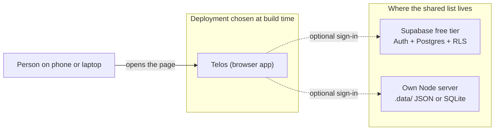
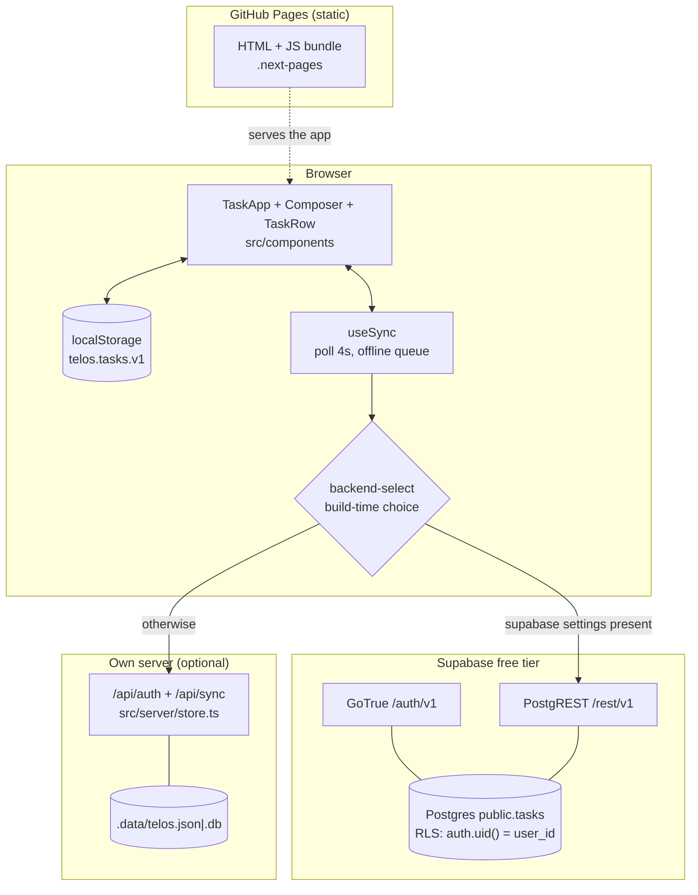

# Telos architecture

A single-page to-do list that works with no account and no network, and can share
one list across devices when you turn sync on. One codebase, two deployments.

| | **Self-hosted** | **Free on GitHub Pages** |
|---|---|---|
| Served by | `next build` + `npm start` (Node) | static export in `.next-pages` |
| Accounts and data | this app's server, `.data/telos.json` or `.data/telos.db` | Supabase Auth + Postgres |
| API calls | `POST /api/auth`, `POST /api/sync` (same origin) | GoTrue and PostgREST at the Supabase URL |
| Needs | a host with a writable disk | nothing but a Supabase free project |
| Offline | yes | yes |

Both use the same sync engine, merge rules and UI. Only the backend differs, and
it is chosen once at build time from the environment (`src/lib/backend-select.ts`).

## Context



## Containers



The browser is the only place tasks are edited. Nothing is rendered on a server,
which is what lets the whole app be a static export.

## Data model

One table, owned per user (`supabase/migrations/20261125100000_telos_tasks.sql`):

- `user_id`, `id` — primary key `(user_id, id)`; `id` is generated by the client
- `title`, `due` (date), `done`, `created_at`, `completed_at`
- `repeat_rule` (`none|daily|weekly`), `series_id`, `previous_id` — repeating tasks
- `updated_at` — the client's edit clock in epoch ms, used for last-write-wins
- `deleted_at` — a tombstone; deleted tasks are rows, not missing rows, so other
  devices learn about the delete
- `synced_at` — **server** clock, written by a trigger; this is the sync cursor

`src/lib/supabase/map.ts` is the only place that translates between these columns
and the app's `Task` type.

## Sync protocol

1. The client keeps a cursor `since` (0 at first sign-in).
2. **Push**: every task whose `updated_at` is newer than what this device last
   uploaded is upserted (`on_conflict=user_id,id`, `resolution=merge-duplicates`).
3. A `BEFORE INSERT OR UPDATE` trigger does two things: it stamps `synced_at`
   with `clock_timestamp()`, and it **silently drops an update whose `updated_at`
   is not newer than the stored row**. A device that wakes up with stale edits
   therefore cannot overwrite a newer one — the same rule
   `src/server/store-json.ts` applies for the self-hosted backend.
4. **Pull**: `GET /rest/v1/tasks?synced_at=gt.<since>&order=synced_at.asc,id.asc`.
5. The next cursor is the newest `synced_at` seen **minus one millisecond**, so
   rows written in the same millisecond are fetched twice instead of being
   skipped (`nextCursor` in `map.ts`).
6. The client merges with `mergeTaskLists` (last-write-wins per task, tombstones
   win over older copies) and prunes old tombstones.

Edits made offline stay in `localStorage` and queue themselves; the queue is
rebuilt on load by comparing each task's `updated_at` with the in-memory
`pushedRef`, so closing the tab does not lose a change.

No realtime subscription: the client polls every 4 s while the tab is visible and
on `online`/`visibilitychange`. A personal to-do list does not need more, and
polling keeps the failure modes obvious.

## Trust boundaries

- The **anon key is public** — it is inlined into the JavaScript bundle. It
  grants nothing on its own. `public.tasks` has RLS enabled and one policy:
  `auth.uid() = user_id` for select/insert/update/delete, checked on write as
  well, so `user_id` cannot be rewritten to another account.
- The **service_role key must never reach the browser**, CI, or the repository.
  Nothing in this app uses it.
- Sessions are Supabase access/refresh tokens in `localStorage`
  (`telos.sb.session.v1`) — the same exposure model as the rest of the local data.
  There is no third-party script on the page, which is what keeps that acceptable.
- Self-hosted mode is unaffected: HTTP-only cookies, HMAC-signed
  (`src/server/session.ts`), passwords hashed with scrypt (`passwords.ts`).

## Failure modes

| Failure | What the user sees | Why it is safe |
|---|---|---|
| Offline / Supabase unreachable | tasks keep working, "offline" in the sync panel | edits are local-first and queued |
| Access token expired | nothing | refreshed 60 s before expiry, once more on a 401 |
| Refresh token revoked | signed out, list kept | local list is never deleted by a 401 |
| Free project paused after a week idle | sync error until resumed | data is intact; resume from the dashboard |
| RLS misconfigured | empty list, not another user's list | policies default to denying |
| Two devices edit the same task | newest `updated_at` wins | trigger drops the older write |
| Server clock jumps backwards | a few duplicate rows in a pull | merge is idempotent; nothing is lost |
| Very large gap (device offline for weeks) | slower first pull | cursor is monotonic, no gaps |

Known deliberate limits: field-level merge (it is whole-task), shared lists
between two people (every row belongs to one account), attachments, search.

## Cost

GitHub Pages on a public repository is free. Supabase free is $0: 500 MB
database, 50,000 monthly active users, unlimited API requests, 5 GB egress, two
active projects, and a project pauses after a week of low activity
([pricing](https://supabase.com/pricing),
[pausing](https://supabase.com/docs/guides/platform/free-project-pausing)). A
personal list uses a few megabytes, so the limit is not close.

## Verifying a change

```bash
npm test                 # units incl. row mapping, cursor, token expiry
npm run typecheck
supabase start           # local stack (Docker)
supabase db reset        # applies supabase/migrations/*.sql
npm run build:static
```

The SQL layer can be checked without the UI: sign two users in with `curl`,
push a row with each, and confirm that one user cannot read or forge the other's
rows, that an `updated_at` older than the stored row does not overwrite it, and
that `synced_at=gt.<cursor>` returns nothing when nothing changed. Point the
static build at the local stack with
`NEXT_PUBLIC_SUPABASE_URL=http://127.0.0.1:54321` and the local anon key, then
sign up in one browser profile and sign in in another to see the same list.

## Where to change what

| Change | File |
|---|---|
| Table, policy, trigger | `supabase/migrations/*.sql` (re-run `supabase db reset`) |
| Column ↔ Task translation, cursor, expiry | `src/lib/supabase/map.ts` (+ its test) |
| Auth and REST calls | `src/lib/supabase/client.ts` |
| Which backend a build uses | `src/lib/backend-select.ts`, `next.config.mjs` |
| Self-hosted API | `app/api/auth`, `app/api/sync`, `src/server/` |
| Sync engine (poll, queue, merge) | `src/lib/useSync.ts`, `src/lib/tasks.ts` |
| Theme tokens and CSS variables | `src/lib/theme/tokens.ts` |
| Presets (colours, fonts, glass) | `src/lib/theme/presets.ts` (+ `presets.test.ts`) |
| Theme picker UI, account copy of the choice | `src/components/ThemeStudio.tsx`, `src/lib/prefs*.ts`, `app/api/prefs` |
| Copy | `messages/en.json` (run `npm run check:messages`) |

## Theming

Every surface, radius, shadow, font and the frosted-glass blur is a CSS
variable. `app/layout.tsx` turns the presets into `[data-preset="…"]` blocks in
one `<style>` tag and a tiny boot script sets the stored slug before first
paint, so there is no flash and no token data in the JS bundle.

Two rules keep this honest as the app grows:

1. new CSS uses `var(--…)` tokens — a literal `#hex`, `12px` radius or font
   stack is a bug, because that component will ignore every preset;
2. a new preset is one entry in `presets.ts`; nothing else changes. The tests
   check every preset's body text against 4.5:1 contrast and that a glass
   preset (translucent surface) always carries a non-zero `glassBlur`.

The choice is stored per account: `/api/prefs` on the Node backend (a JSON file
next to the task store) or `public.telos_prefs` under Supabase RLS. Only the
preset slug is stored; tokens never leave the bundle.
